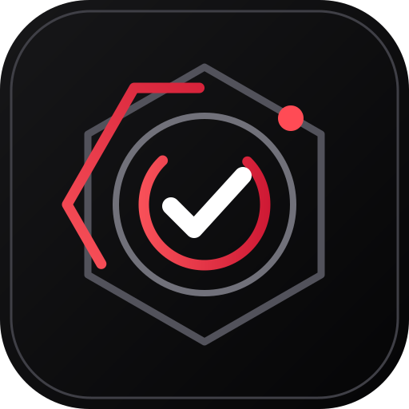

  

<h1 align="center">Red Copilot · Engineering Resources</h1>

  Shared organization identity, community standards, and engineering guidance. 
  Red Copilot 组织的共享品牌、社区规范与工程资源。

  <a href="https://github.com/red-copilot">Organization profile · 组织主页 ↗</a>
  &nbsp;·&nbsp;
  <a href="https://github.com/orgs/red-copilot/repositories">Projects · 核心项目 ↗</a>

## Start here

从这里开始

| Resource | Purpose |
|---|---|
| [`profile/README.md`](profile/README.md) | Organization profile source · 组织主页源文件 |
| [`assets/`](assets/) | Brand marks, light/dark banners, and project icons · 品牌标记、明暗 Banner 与项目图标 |
| [`BRAND.md`](BRAND.md) | Signal Editorial identity, metadata, and accessibility rules · 品牌规范与元数据 |
| [`CONTRIBUTING.md`](CONTRIBUTING.md) | Contribution and review expectations · 贡献与评审规范 |
| [`SECURITY.md`](SECURITY.md) | Vulnerability reporting and authorization guidance · 漏洞报告与授权边界 |

## README standard

README 编写规范

Every project README should help a new reader answer four questions quickly:

1. **What is it?** State the purpose, intended users, and current scope. 
   项目是什么？明确目的、目标用户与当前范围。
2. **What works today?** Separate implemented capabilities from planned work and known limitations. 
   现在能做什么？区分已实现能力、计划与已知限制。
3. **How do I start?** Provide a minimal, accurate quick-start path with prerequisites. 
   如何开始？提供最小且可维护的快速开始路径与环境要求。
4. **Where are the details?** Link to authoritative architecture, configuration, API, deployment, and operations documentation. 
   权威细节在哪里？链接到架构、配置、API、部署与运维文档。

## Shared presentation

统一展示约定

- Place English first and Chinese directly below it. 
  英文在上，中文紧随其下。
- Use the shared organization banner where it improves recognition. 
  在适合的项目中使用共享 Banner。
- Use diagrams grounded in the actual implementation. 
  图表应反映真实实现。
- Use badges sparingly; every badge must be factual, current, and verifiable. 
  少用徽章，且每个徽章都应真实、及时、可核验。
- Do not claim tests passed unless they were actually run. 
  未实际执行的测试不得宣称通过。
- Explain authorization boundaries, permissions, failure modes, and known limitations. 
  明确说明授权边界、权限、失败模式与已知限制。

## Contribute and report

参与贡献与漏洞报告

Use the [contribution guide](CONTRIBUTING.md) for code, tests, documentation, and architecture discussions. Report vulnerabilities through the [security policy](SECURITY.md) rather than a public issue.

代码、测试、文档与架构讨论请遵循贡献指南；漏洞请通过安全政策私下报告。
