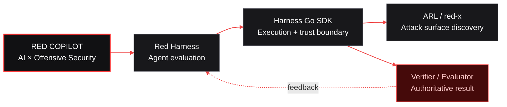

  <picture>
    <source media="(prefers-color-scheme: dark)" srcset="https://raw.githubusercontent.com/red-copilot/.github/main/assets/red-copilot-banner.svg" />
    <source media="(prefers-color-scheme: light)" srcset="https://raw.githubusercontent.com/red-copilot/.github/main/assets/red-copilot-banner-light.svg" />
    
  </picture>

<h2 align="center">AI-Native Offensive Security Engineering</h2>

  <strong>Autonomy needs control. Results need evidence.</strong>

  <kbd>PLAN</kbd>&nbsp;&nbsp;→&nbsp;&nbsp;
  <kbd>EXECUTE</kbd>&nbsp;&nbsp;→&nbsp;&nbsp;
  <kbd>OBSERVE</kbd>&nbsp;&nbsp;→&nbsp;&nbsp;
  <kbd>VERIFY</kbd>

---

## What we build

Red Copilot engineers reliable AI systems for offensive security. We build the infrastructure around the model: execution boundaries, tool feedback, state tracking, budget control, observability, and independent verification.

**A convincing agent response is not proof of success.** Systems should be judged by reproducible outcomes and evidence from the environment—not by the model’s claims alone.

<table>
  <tr>
    <td width="33%" valign="top">
      <h3>01 / Agent autonomy</h3>
      
Multi-step agents that plan, act, observe, recover, and adapt as the environment changes.

    </td>
    <td width="33%" valign="top">
      <h3>02 / Execution control</h3>
      
Explicit scope, isolated runtimes, bounded budgets, least privilege, and traceable tool use.

    </td>
    <td width="33%" valign="top">
      <h3>03 / Evidence-based evaluation</h3>
      
Independent verifiers, reproducible tasks, structured traces, and measurable results.

    </td>
  </tr>
</table>

## System map

Only the verifier or benchmark evaluator can close the loop.

## Projects

<table>
  <tr>
    <td width="33%" valign="top">
      

      <h3 align="center"><a href="https://github.com/red-copilot/red-copilot">Red Harness</a></h3>
      
<strong>EVALUATE</strong>

      
A reproducible evaluation runtime for security agents. Task contracts, isolated execution, budgets, telemetry, and authoritative verification form one closed loop.

      
<code>Python</code> <code>Docker</code> <code>Pi</code>

    </td>
    <td width="33%" valign="top">
      

      <h3 align="center"><a href="https://github.com/red-copilot/harness">Harness Go SDK</a></h3>
      
<strong>EXECUTE</strong>

      
A Go-native execution and trust boundary with container isolation, Pi RPC transport, SQLite audit records, and authoritative verification.

      
<code>Go</code> <code>Docker</code> <code>SQLite</code>

    </td>
    <td width="33%" valign="top">
      

      <h3 align="center"><a href="https://github.com/red-copilot/red-x">ARL / red-x</a></h3>
      
<strong>DISCOVER</strong>

      
An authorization-first external attack surface management and asset reconnaissance platform with traceable assets, risk, tasks, and reports.

      
<code>Go</code> <code>React</code> <code>PostgreSQL</code>

    </td>
  </tr>
</table>

## Engineering principles

<table>
  <tr>
    <td width="50%" valign="top">
      <h3>Authorization first</h3>
      
Authorization is the starting condition, not a disclaimer. Testing stays within explicitly permitted scope.

    </td>
    <td width="50%" valign="top">
      <h3>Evidence over claims</h3>
      
Agent messages and tool exit codes are observations. Only a verifier or benchmark evaluator can produce a successful verdict.

    </td>
  </tr>
  <tr>
    <td width="50%" valign="top">
      <h3>Isolated by default</h3>
      
Containers, networks, credentials, and filesystems are isolated by default. Dangerous capabilities must be explicitly enabled.

    </td>
    <td width="50%" valign="top">
      <h3>Reproducible by design</h3>
      
Tasks, seeds, environments, budgets, traces, and results are auditable, replayable, and comparable.

    </td>
  </tr>
</table>

## Enter the system

  <a href="https://github.com/orgs/red-copilot/repositories"><strong>Browse repositories →</strong></a>
  &nbsp;&nbsp;·&nbsp;&nbsp;
  <a href="https://github.com/red-copilot/.github/blob/main/CONTRIBUTING.md">Contribute</a>
  &nbsp;&nbsp;·&nbsp;&nbsp;
  <a href="https://github.com/red-copilot/.github/blob/main/SECURITY.md">Security policy</a>

  <strong>Build autonomous systems. Prove real outcomes.</strong>

  All security testing must be limited to systems you own or are explicitly authorized to assess.

