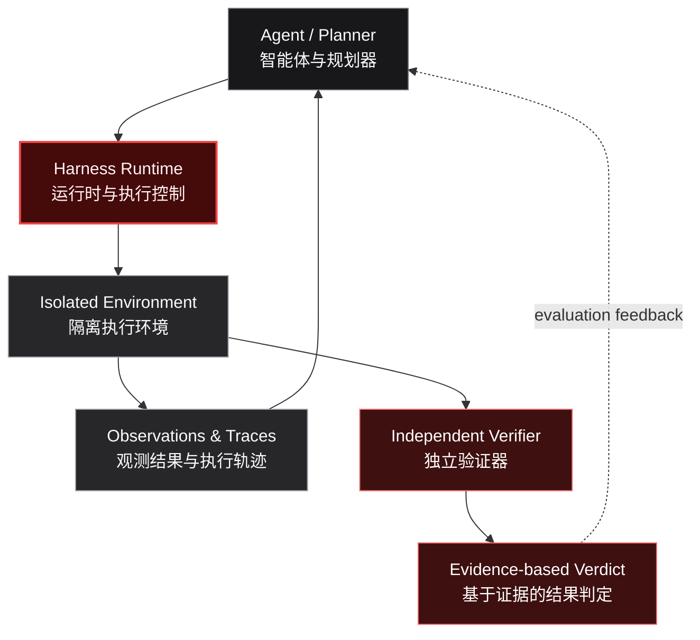

  <picture>
    <source media="(prefers-color-scheme: dark)" srcset="https://raw.githubusercontent.com/red-copilot/.github/main/assets/red-copilot-banner.svg" />
    <source media="(prefers-color-scheme: light)" srcset="https://raw.githubusercontent.com/red-copilot/.github/main/assets/red-copilot-banner-light.svg" />
    
  </picture>

  INDEPENDENT SECURITY ENGINEERING · AGENT SYSTEMS · REPRODUCIBLE EVALUATION

<h1 align="center">Autonomy needs control. Results need evidence.</h1>

自主能力需要工程控制，任务结果必须有证据支撑。

  We engineer the systems that make security agents measurable, bounded, and reliable.
   
  我们构建让安全智能体可衡量、可约束、可信赖的工程系统。

  <code>PLAN</code> &nbsp;→&nbsp; <code>EXECUTE</code> &nbsp;→&nbsp; <code>OBSERVE</code> &nbsp;→&nbsp; <code>VERIFY</code>
   
  规划 → 执行 → 观察 → 验证

---

## The idea
核心理念

**A model saying “done” is not a test passing.**

The hard part of an autonomous security agent is not just choosing the next tool. It is controlling what the agent can do, giving it useful feedback, recovering from failure, and independently proving what happened.

**模型说“完成了”，不等于测试真正通过。** 自主安全智能体的难点不只是选择工具，而是约束执行权限、提供有效反馈、从失败中恢复，并独立验证实际发生的结果。

## What we engineer
工程方向

<table>
  <tr>
    <td width="33%" valign="top">
      
<strong>01 / AGENT SYSTEMS</strong>

      <h3>Make agents adaptive</h3>
      
Multi-step planning, tool use, state tracking, feedback, and recovery.

      
让智能体具备多步骤规划、工具调用、状态跟踪、反馈处理与故障恢复能力。

    </td>
    <td width="33%" valign="top">
      
<strong>02 / EXECUTION CONTROL</strong>

      <h3>Make actions bounded</h3>
      
Explicit scope, isolated environments, least privilege, budgets, and audit trails.

      
通过明确授权范围、环境隔离、最小权限、预算限制与审计轨迹约束执行。

    </td>
    <td width="33%" valign="top">
      
<strong>03 / EVALUATION</strong>

      <h3>Make outcomes verifiable</h3>
      
Task contracts, independent verification, reproducible runs, and comparable results.

      
以任务契约、独立验证、可复现运行和可比较结果衡量系统能力。

    </td>
  </tr>
</table>

## System architecture
系统架构

The agent proposes actions. The environment produces observations. The verifier determines success. 智能体提出行动，环境产生观测，验证器判定是否成功。

## Project portfolio
项目版图

<table>
  <tr>
    <td width="33%" valign="top">
      
<strong>01 — EVALUATE</strong>

      <h3>Red Harness</h3>
      
A reproducible runtime for evaluating security agents through task contracts, bounded execution, telemetry, and authoritative verification.

      
面向安全智能体的可复现评测运行时，整合任务契约、受控执行、运行遥测与权威验证。

      
<code>Agent Evaluation</code> <code>Python</code> <code>Docker</code>

      
Repository: private development

    </td>
    <td width="33%" valign="top">
      
<strong>02 — EXECUTE</strong>

      <h3>Harness Go SDK</h3>
      
A Go-native execution boundary for controlled tool access, isolated workloads, audit records, and verification.

      
原生 Go 执行边界，为受控工具访问、隔离任务、审计记录和结果验证提供基础能力。

      
<code>Go</code> <code>Docker</code> <code>SQLite</code>

      
Repository: private development

    </td>
    <td width="33%" valign="top">
      
<strong>03 — DISCOVER</strong>

      <h3>ARL / red-x</h3>
      
An authorization-first attack-surface and asset reconnaissance platform built around traceable assets, risks, tasks, and reports.

      
以授权为先的攻击面管理与资产侦察平台，围绕可追踪的资产、风险、任务和报告组织工作流。

      
<code>Attack Surface</code> <code>Go</code> <code>React</code>

      
Repository: private development

    </td>
  </tr>
</table>

## Engineering principles
工程原则

| Principle | 中文说明 |
|---|---|
| **Authorization first** | 授权是开始测试的前置条件，不是事后补充的免责声明。 |
| **Evidence over claims** | 智能体自述不是成功证据；结论必须来自独立验证。 |
| **Isolation by default** | 默认隔离环境、网络、凭据与文件系统；高风险能力必须显式启用。 |
| **Bounded execution** | 对范围、时间、调用次数和资源消耗设置明确边界。 |
| **Reproducibility** | 让任务、环境、执行轨迹和结果可审计、可回放、可比较。 |

## Explore
了解与参与

  <a href="https://github.com/orgs/red-copilot/repositories"><strong>Browse repositories ↗</strong></a>
  &nbsp;&nbsp;·&nbsp;&nbsp;
  <a href="https://github.com/red-copilot/.github/blob/main/CONTRIBUTING.md">Contributing</a>
  &nbsp;&nbsp;·&nbsp;&nbsp;
  <a href="https://github.com/red-copilot/.github/blob/main/SECURITY.md">Security policy</a>
   
  浏览仓库 · 参与贡献 · 阅读安全政策

  <strong>Build autonomous systems. Prove real outcomes.</strong>
   
  构建自主系统，以真实结果验证能力。

Security testing must be limited to systems you own or are explicitly authorized to assess. 所有安全测试仅限于自有系统或已获得明确授权的目标。

