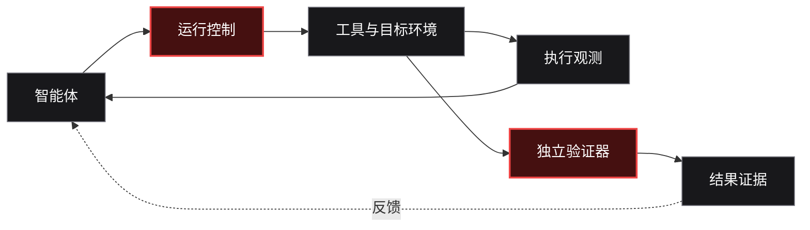

  <picture>
    <source media="(prefers-color-scheme: dark)" srcset="https://raw.githubusercontent.com/red-copilot/.github/main/assets/red-copilot-banner.svg" />
    <source media="(prefers-color-scheme: light)" srcset="https://raw.githubusercontent.com/red-copilot/.github/main/assets/red-copilot-banner-light.svg" />
    
  </picture>

  <strong>面向智能体时代的进攻性安全工程</strong>
   
  让安全智能体不止能够行动，更能够验证结果。

<h1 align="center">自主行动不够， 结果必须可验证。</h1>

  我们构建安全智能体的工程基础设施， 
  让任务执行具备明确边界、完整观测与独立验证。

  <code>规划</code> → <code>执行</code> → <code>观测</code> → <code>验证</code>

  <a href="https://github.com/orgs/red-copilot/repositories">浏览全部项目</a> ·
  <a href="https://github.com/red-copilot/.github/blob/main/CONTRIBUTING.md">参与贡献</a> ·
  <a href="https://github.com/red-copilot/.github/blob/main/SECURITY.md">安全政策</a>

---

## 我们相信什么

### 智能体的声明，不等于事实。

一个模型声称任务已完成，不代表目标真的达成；工具返回成功，也不代表结果正确。

可靠的安全自动化需要的不只是更强的模型，还需要明确的授权范围、受控的执行环境、有效的反馈机制、可恢复的工作流，以及独立于智能体的结果验证。

## 我们构建什么

<table>
  <tr>
    <td width="33%" valign="top">
      
<strong>01 / 智能体运行时</strong>

      <h3>让复杂任务有序运行</h3>
      
处理智能体接入、工具编排、会话状态、反馈闭环与失败恢复。

    </td>
    <td width="33%" valign="top">
      
<strong>02 / 执行控制</strong>

      <h3>让行动始终处于边界内</h3>
      
通过授权范围、环境隔离、最小权限、资源预算与审计轨迹约束执行。

    </td>
    <td width="33%" valign="top">
      
<strong>03 / 独立验证</strong>

      <h3>让结果能够被证明</h3>
      
使用任务契约、独立验证器、可复现实验与证据记录判断任务是否真正完成。

    </td>
  </tr>
</table>

## 系统如何工作

  智能体提出行动，环境产生反馈，验证器依据证据作出判定。

## 项目版图

<table>
  <tr>
    <td width="50%" valign="top">
      
<strong>01 — 智能体评测与运行时</strong>

      <h3><a href="https://github.com/red-copilot/red-harness">Red Harness</a></h3>
      
面向安全智能体的可复现评测运行时。将任务、智能体、目标环境、模型与工具访问、预算、遥测和验证机制清晰分离，让执行过程可追踪、结果可复核。

      
<code>智能体评测</code> <code>Python</code> <code>Docker</code>

    </td>
    <td width="50%" valign="top">
      
<strong>02 — 工程化与系统集成</strong>

      <h3>运行时与 SDK 生态</h3>
      
围绕受控执行、标准化接口与工程集成，逐步构建可复用的安全自动化基础组件。

      
<code>运行时</code> <code>SDK</code> <code>系统集成</code>

    </td>
  </tr>
  <tr>
    <td width="50%" valign="top">
      
<strong>03 — 安全研究工作流</strong>

      <h3>授权范围内的自动化探索</h3>
      
探索资产发现、任务执行与结果整理的工程化流程，强调授权边界、过程留痕与结果验证。

      
<code>安全研究</code> <code>自动化</code> <code>可追溯</code>

    </td>
    <td width="50%" valign="top">
      
<strong>04 — 评测与基准接入</strong>

      <h3>让实验可复现、可比较</h3>
      
通过统一的基准适配与任务生命周期管理，记录执行过程与评测结果，为不同智能体方案提供可比较的实验依据。

      
<code>基准测试</code> <code>实验复现</code> <code>结果审计</code>

    </td>
  </tr>
</table>

## 工程原则

| 原则 | 实践方式 |
|---|---|
| **授权优先** | 先确认授权与测试范围，再执行安全任务。 |
| **证据优先** | 由可检查的证据支持结论，而不是依赖模型自述。 |
| **默认隔离** | 隔离执行环境、凭据与资源访问，降低越界风险。 |
| **有界执行** | 对权限、时间、调用次数与资源消耗设定限制。 |
| **可复现** | 让任务配置、执行轨迹与结果可以审计、回放和比较。 |
| **明确职责** | 将任务、环境、智能体、模型、工具与验证器分离，减少职责混杂。 |

## 加入我们

我们关注的不只是让智能体“跑起来”，而是建立一套能够持续评测、可靠执行并验证结果的安全工程体系。

- 浏览组织中的开源项目，了解当前实现与进展。
- 通过问题反馈、测试用例、文档和代码改进参与建设。
- 讨论架构时优先提供可复现的案例、数据与证据。

  <strong>构建能够行动的智能体，打造能够证明结果的工程系统。</strong>
    
  <a href="https://github.com/orgs/red-copilot/repositories">查看全部仓库 ↗</a>

仅用于获得授权的安全测试、竞赛与研究。

