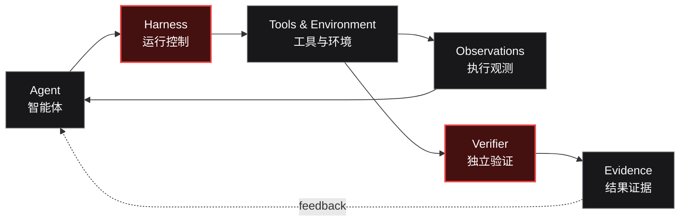

  <picture>
    <source media="(prefers-color-scheme: dark)" srcset="https://raw.githubusercontent.com/red-copilot/.github/main/assets/red-copilot-banner.svg" />
    <source media="(prefers-color-scheme: light)" srcset="https://raw.githubusercontent.com/red-copilot/.github/main/assets/red-copilot-banner-light.svg" />
    
  </picture>

  <strong>AI-NATIVE SECURITY ENGINEERING</strong> 
  面向智能体时代的安全工程

<h1 align="center">Autonomy is not enough. Make it measurable.</h1>

仅有自主能力还不够，更要让能力可衡量、可验证。

  We build the infrastructure for security agents to plan, act, learn from feedback, and prove outcomes.
   
  我们构建安全智能体的工程基础设施，让它们能够规划、执行、接收反馈，并以证据证明结果。

  <code>PLAN</code> → <code>EXECUTE</code> → <code>OBSERVE</code> → <code>VERIFY</code>
   
  规划 → 执行 → 观测 → 验证

  <a href="https://github.com/orgs/red-copilot/repositories">Explore repositories</a> ·
  <a href="https://github.com/red-copilot/.github/blob/main/CONTRIBUTING.md">Contribute</a> ·
  <a href="https://github.com/red-copilot/.github/blob/main/SECURITY.md">Security</a>
   
  浏览项目 · 参与贡献 · 安全政策

---

## What we believe
我们的理念

### An agent's claim is not evidence.
智能体的自我声明，不等于可信证据。

Reliable security automation takes more than a capable model. It needs explicit scope, controlled execution, useful feedback, recoverable workflows, and independent verification.

可靠的安全自动化不只依赖强大的模型，还需要明确的任务范围、受控执行、有效反馈、可恢复的工作流，以及独立验证机制。

## What we build
我们构建什么

<table>
  <tr>
    <td width="33%" valign="top">
      
<strong>01 / AGENT RUNTIME</strong>

      <h3>Coordinate complex work</h3>
      
Planning, tool orchestration, state management, feedback loops, and failure recovery.

      
规划、工具编排、状态管理、反馈闭环与故障恢复。

    </td>
    <td width="33%" valign="top">
      
<strong>02 / EXECUTION CONTROL</strong>

      <h3>Keep actions bounded</h3>
      
Authorization scope, isolated environments, least privilege, resource budgets, and audit trails.

      
授权范围、环境隔离、最小权限、资源预算与审计轨迹。

    </td>
    <td width="33%" valign="top">
      
<strong>03 / VERIFICATION</strong>

      <h3>Prove what happened</h3>
      
Task contracts, independent checks, reproducible experiments, and evidence-backed results.

      
任务契约、独立检查、可复现实验与证据驱动的结果判定。

    </td>
  </tr>
</table>

## How the system works
系统如何工作

  The agent proposes. The environment responds. The verifier decides.
   
  智能体提出行动，环境反馈结果，验证器依据证据作出判定。

## Project portfolio
项目版图

<table>
  <tr>
    <td width="33%" valign="top">
      
<strong>01 — EVALUATION</strong>

      <h3><a href="https://github.com/red-copilot/red-harness">Red Harness</a></h3>
      
A controlled, reproducible environment for testing security-agent capabilities.

      
用于测试安全智能体能力的受控、可复现运行环境。

      
<code>Agent Evaluation</code> <code>Python</code> · <code>Docker</code>

    </td>
    <td width="33%" valign="top">
      
<strong>02 — EXECUTION</strong>

      <h3>Red Harness Go SDK</h3>
      
Go-native building blocks for controlled execution and integration.

      
面向受控执行与系统集成的 Go 原生基础组件。

      
<code>Go</code> · <code>SDK</code> · <code>Runtime</code>

    </td>
    <td width="33%" valign="top">
      
<strong>03 — RECONNAISSANCE</strong>

      <h3>Attack Surface Intelligence</h3>
      
Asset discovery and security workflows designed around traceability and authorization.

      
以可追踪性与授权为核心的资产发现和安全工作流。

      
<code>Attack Surface</code> · <code>Automation</code>

    </td>
  </tr>
</table>

## Engineering principles
工程原则

| Principle | 中文说明 |
|---|---|
| **Authorization first** | 先确认授权与测试边界，再执行安全任务。 |
| **Evidence over claims** | 结论由可检查的证据支持，而不是模型自述。 |
| **Isolation by default** | 默认隔离执行环境、凭据与资源访问。 |
| **Bounded execution** | 对权限、时间、调用次数与资源消耗设置边界。 |
| **Reproducibility** | 让任务、环境、轨迹和结果可审计、可回放、可比较。 |

---

  <strong>Build agents that can act. Engineer systems that can prove.</strong>
   
  构建能够行动的智能体，打造能够验证结果的工程系统。

  <a href="https://github.com/orgs/red-copilot/repositories">All repositories ↗</a>
   
  查看全部仓库

For authorized security testing and research only. 仅用于获得授权的安全测试与研究。

