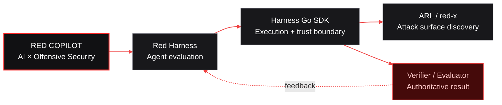

  <picture>
    <source media="(prefers-color-scheme: dark)" srcset="https://raw.githubusercontent.com/red-copilot/.github/main/assets/red-copilot-banner.svg" />
    <source media="(prefers-color-scheme: light)" srcset="https://raw.githubusercontent.com/red-copilot/.github/main/assets/red-copilot-banner-light.svg" />
    
  </picture>

<h2 align="center">AI-Native Offensive Security Engineering 面向 AI 的进攻性安全工程</h2>

  <strong>Build autonomous systems. Prove real outcomes.</strong> 构建自主系统，以真实结果验证能力。 构建自主系统，以真实结果验证能力。

  <kbd>PLAN</kbd>&nbsp;&nbsp;→&nbsp;&nbsp;
  <kbd>EXECUTE</kbd>&nbsp;&nbsp;→&nbsp;&nbsp;
  <kbd>OBSERVE</kbd>&nbsp;&nbsp;→&nbsp;&nbsp;
  <kbd>VERIFY</kbd>

---

## What we build

<small>我们构建什么</small>

Red Copilot engineers reliable AI systems for offensive security. We build the infrastructure around the model: execution boundaries, tool feedback, state tracking, budget control, observability, and independent verification.

<small>Red Copilot 致力于构建可靠的 AI 进攻性安全系统。我们关注模型之外的工程基础设施：执行边界、工具反馈、状态跟踪、预算控制、可观测性与独立验证。</small>

**A convincing agent response is not proof of success.** Systems should be judged by reproducible outcomes and evidence from the environment—not by the model’s claims alone.

<small>智能体给出令人信服的回答，不代表任务真正成功。系统应以可复现的结果和环境证据作为判断依据，而不是仅凭模型自述。</small>

<table>
  <tr>
    <td width="33%" valign="top">
      <h3>01 / Agent autonomy 智能体自主性</h3>
      
Multi-step agents that plan, act, observe, recover, and adapt as the environment changes.

<small>能够规划、行动、观察、恢复，并随环境变化持续调整的多步骤智能体。</small>

    </td>
    <td width="33%" valign="top">
      <h3>02 / Execution control 执行控制</h3>
      
Explicit scope, isolated runtimes, bounded budgets, least privilege, and traceable tool use.

<small>通过明确的授权范围、隔离运行时、预算限制、最小权限和可追溯工具调用控制执行过程。</small>

    </td>
    <td width="33%" valign="top">
      <h3>03 / Evidence-based evaluation 基于证据的评测</h3>
      
Independent verifiers, reproducible tasks, structured traces, and measurable results.

<small>通过独立验证器、可复现任务、结构化轨迹和可量化结果评估系统能力。</small>

    </td>
  </tr>
</table>

## System map

<small>系统架构</small>

Only the verifier or benchmark evaluator can close the loop. 只有验证器或基准评测器才能完成最终判定并闭合反馈循环。

## Projects

<small>项目矩阵</small>

<table>
  <tr>
    <td width="33%" valign="top">
      

      <h3 align="center"><a href="https://github.com/red-copilot/red-copilot">Red Harness</a> 智能体评测与编排框架</h3>
      
<strong>EVALUATE</strong>

      
A reproducible evaluation runtime for security agents. Task contracts, isolated execution, budgets, telemetry, and authoritative verification form one closed loop.

<small>面向安全智能体的可复现评测运行时，将任务契约、隔离执行、预算、遥测与权威验证整合为闭环。</small>

      
<code>Python</code> <code>Docker</code> <code>Pi</code>

    </td>
    <td width="33%" valign="top">
      

      <h3 align="center"><a href="https://github.com/red-copilot/harness">Harness Go SDK</a> Go 执行与信任边界 SDK</h3>
      
<strong>EXECUTE</strong>

      
A Go-native execution and trust boundary with container isolation, Pi RPC transport, SQLite audit records, and authoritative verification.

<small>原生 Go 执行与信任边界，提供容器隔离、Pi RPC 通信、SQLite 审计记录与权威验证。</small>

      
<code>Go</code> <code>Docker</code> <code>SQLite</code>

    </td>
    <td width="33%" valign="top">
      

      <h3 align="center"><a href="https://github.com/red-copilot/red-x">ARL / red-x</a> 攻击面发现与资产分析</h3>
      
<strong>DISCOVER</strong>

      
An authorization-first external attack surface management and asset reconnaissance platform with traceable assets, risk, tasks, and reports.

<small>以授权为先的外部攻击面管理与资产侦察平台，支持资产、风险、任务和报告的全程追踪。</small>

      
<code>Go</code> <code>React</code> <code>PostgreSQL</code>

    </td>
  </tr>
</table>

## Engineering principles

<small>工程原则</small>

<table>
  <tr>
    <td width="50%" valign="top">
      <h3>Authorization first 授权优先</h3>
      
Authorization is the starting condition, not a disclaimer. Testing stays within explicitly permitted scope.

<small>授权是测试的前置条件，而不是免责声明。所有测试均限定在明确许可的范围内。</small>

    </td>
    <td width="50%" valign="top">
      <h3>Evidence over claims 证据优于自述</h3>
      
Agent messages and tool exit codes are observations. Only a verifier or benchmark evaluator can produce a successful verdict.

<small>智能体消息和工具退出码都只是观测信息；成功结论必须由验证器或基准评测器给出。</small>

    </td>
  </tr>
  <tr>
    <td width="50%" valign="top">
      <h3>Isolated by default 默认隔离</h3>
      
Containers, networks, credentials, and filesystems are isolated by default. Dangerous capabilities must be explicitly enabled.

<small>默认隔离容器、网络、凭据与文件系统；高风险能力必须经过显式授权才能启用。</small>

    </td>
    <td width="50%" valign="top">
      <h3>Reproducible by design 可复现设计</h3>
      
Tasks, seeds, environments, budgets, traces, and results are auditable, replayable, and comparable.

<small>任务、随机种子、环境、预算、执行轨迹和结果均应可审计、可回放、可比较。</small>

    </td>
  </tr>
</table>

## Enter the system

<small>开始探索</small>

  <a href="https://github.com/orgs/red-copilot/repositories"><strong>Browse repositories →</strong></a>
  &nbsp;&nbsp;·&nbsp;&nbsp;
  <a href="https://github.com/red-copilot/.github/blob/main/CONTRIBUTING.md">Contribute</a>
  &nbsp;&nbsp;·&nbsp;&nbsp;
  <a href="https://github.com/red-copilot/.github/blob/main/SECURITY.md">Security policy</a>

  <strong>Build autonomous systems. Prove real outcomes.</strong>

  All security testing must be limited to systems you own or are explicitly authorized to assess. 所有安全测试仅限于自有系统或已获得明确授权的目标。

